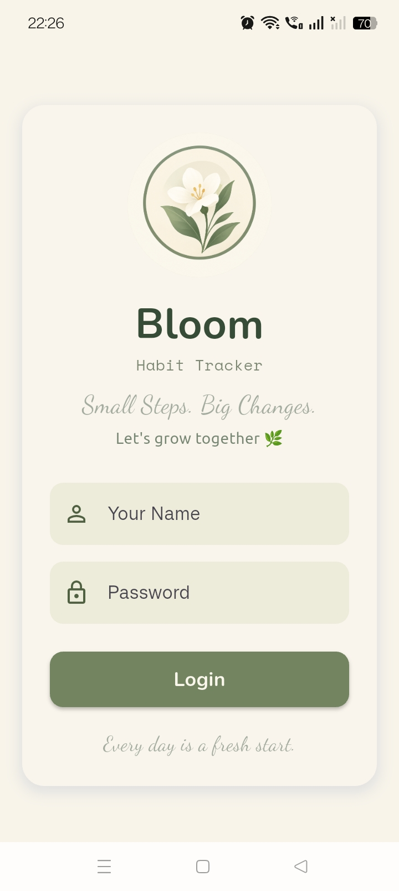
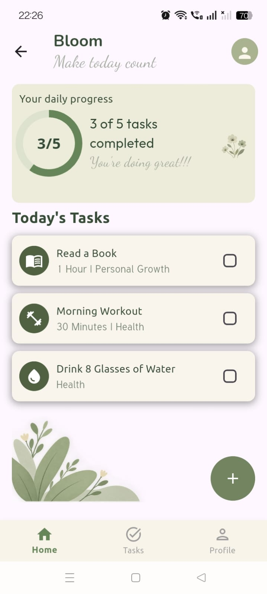

# 🌸 Bloom — Habit Tracker

**Small Steps. Big Changes. 🌱**

Bloom is a Flutter-based habit tracker designed to help users build positive habits and stay consistent with their daily goals. With a calming, nature-inspired UI, Bloom makes tracking everyday habits simple and enjoyable.

## ✨ Features

- ✅ Track daily habits using interactive checkboxes.
- 📊 View daily progress with a circular progress indicator.
- 🎨 Clean and calming UI with a nature-inspired color palette.
- 🔐 Login screen with navigation to the homepage.

## 📱 Screenshots

| Login Screen | Homepage |
|:---:|:---:|
|  | |

## 🛠️ Built With

- Flutter
- Dart
- Google Fonts

## 🚀 Getting Started

Clone the repository and navigate to the project folder:

```bash
git clone https://github.com/priyanshu6143/bloom.git
cd bloom
```

Install dependencies and run the application:

```bash
flutter pub get
flutter run
```

## 👩‍💻 Author

**Priyanshu**

[GitHub Profile](https://github.com/priyanshu6143)

---

*Grow a little every day. 🌿*
